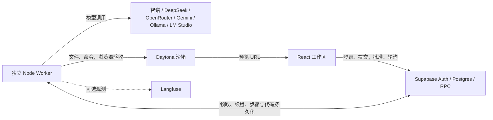

# Forge — 从需求到可交互网页

Forge 是一个 idea-to-app 原型：用户用自然语言描述需求，审阅计划后，由 Agent 编写代码，在 Daytona 沙箱中构建、启动，并在工作区查看源码与网页预览。用户可以继续修改同一个项目，也可以暂停执行、检查日志或导出源码。

**当前定位：面向 React 网页与小游戏的可运行原型。** 已有真实模型、Supabase 和 Daytona 联调经历及可交互的推箱子示例；生成可靠性仍有已知问题，不能保证任意需求一次成功。公网部署及评委账号的最终访问验收尚未确认。

实现思路、取舍及验证记录见 [项目交付说明](SUBMISSION.md)。本文说明当前源码的运行方式，核对日期为 **2026-09-28**。

## 1. 如何体验

1. 注册并登录，或使用提交渠道单独提供的示例账号。不同账号的项目相互隔离。
2. 新建项目，输入需求，例如“创建中文待办网页，支持添加、完成和删除任务”。默认 **Plan** 模式。
3. 审阅计划、设计方向和验收条件；可补充信息或提出修改，随后批准当前版本。
4. **Build** 在后台读取已有代码、修改文件、安装依赖、构建并启动预览，然后执行浏览器验收。
5. 查看实时活动、详细日志、文件树和预览；后续需求继续提交到同一项目。

也可以直接选择 Build，此时平台生成简短行动计划后执行。预览可访问与任务验收成功是两个状态：任务可能已经产出可玩的页面，但尚未通过全部验收。

已有示例适合快速观察结果；新建项目适合体验完整生成流程。示例账号凭据通过提交渠道提供，不存放在源码或公开 README 中。

## 2. 架构与运行边界



| 目录 | 职责 |
|---|---|
| `app/frontend` | React、Vite、TypeScript 工作区；登录、计划审阅、任务控制、日志、文件和预览 |
| `app/worker` | Node.js ReAct 执行循环；模型适配、沙箱管理、浏览器验收、恢复和清理队列 |
| `app/backend/migrations` | 数据表、复合外键、RLS 和受控 RPC；不是需要单独启动的 HTTP 后端 |
| `app/backend/tests` | PGlite 本地数据库与权限测试 |

当前按 **一个常驻 Worker** 部署。任务队列存于 Supabase；关闭浏览器不负责终止后台任务，但 Worker 必须持续在线。Worker 离线时，生成、删除和预览恢复请求会等待处理。

生成应用与 Forge 平台分别运行：前者在 Daytona 中启动自己的开发服务；后者在本地或静态托管服务运行。平台的 Supabase 不会自动成为生成应用的业务数据库。当前主要支持前端应用及浏览器本地存储，全栈应用的后端、数据库和第三方凭据尚未自动配置。

## 3. 本地运行

### 准备条件

- Node.js 20 或以上；本地验证环境为 Node.js **24.15.0**、pnpm **11.7.0**。
- 前端使用 pnpm 与 `pnpm-lock.yaml`；Worker 和数据库测试使用 npm 与各自的 `package-lock.json`。
- 一个 Supabase 项目、Daytona API Key，以及智谱或 DeepSeek 的可用 API Key；Worker 能连接这些服务。Langfuse 为可选项。

以下命令适用于 Linux / WSL。明确标注“从项目根目录”的代码块均从包含本 README 的目录开始。配置复制命令会保留已有 `.env`。

### 3.1 初始化 Supabase

在 Supabase 项目的 SQL Editor 中，**按顺序完整执行**：

| 顺序 | 文件 | 作用 |
|---|---|---|
| 1 | [0001_init.sql](app/backend/migrations/0001_init.sql) | 项目、消息、任务、文件、快照、记忆及基础权限 |
| 2 | [0002_plan_review.sql](app/backend/migrations/0002_plan_review.sql) | 计划版本、批准、重试与执行标识 |
| 3 | [0003_deletion_retention.sql](app/backend/migrations/0003_deletion_retention.sql) | 项目清理、偏好建议、反馈与审计 |
| 4 | [0004_task_pause.sql](app/backend/migrations/0004_task_pause.sql) | 暂停、继续与执行失效 |
| 5 | [0005_preview_recovery.sql](app/backend/migrations/0005_preview_recovery.sql) | 已有沙箱的预览恢复队列 |
| 6 | [0006_workspace_contract.sql](app/backend/migrations/0006_workspace_contract.sql) | 统一源码 Change Set、revision、证据与 checkpoint |

升级已有数据库时，先停止旧 Worker，再执行尚未应用的迁移、更新源码并重启；不要重新初始化已有业务数据。`Success. No rows returned` 说明 SQL 已执行，不代表整个应用已完成验收。

在 Authentication 中启用 Email 登录和所需注册策略。若开启邮箱确认，用户需确认邮件后登录。在 URL Configuration 中将本地 Site URL 和允许的跳转地址配置为 `http://localhost:5173`；公网部署后补充实际前端地址。本项目注册请求的邮件跳转目标是前端的 origin。

### 3.2 前端

从项目根目录，在第一个终端执行：

```bash
cd app/frontend
pnpm install --frozen-lockfile
test -f .env || cp .env.example .env
```

编辑 `app/frontend/.env`：

```dotenv
VITE_SUPABASE_URL=https://YOUR_PROJECT.supabase.co
VITE_SUPABASE_ANON_KEY=YOUR_PUBLIC_ANON_KEY
```

在该目录启动，然后打开 **http://localhost:5173**：

```bash
pnpm run dev --port 5173 --strictPort
```

Vite 配置文件自身默认使用 3000 端口，以上命令明确指定 5173；若被占用会报错，避免自动切换到另一个地址。

所有 `VITE_*` 变量会进入浏览器构建。模型、Daytona、Supabase service role 和 Langfuse secret key **只放 Worker**。修改前端环境变量后需重启开发服务；静态部署则需要重新构建。

### 3.3 Worker

从项目根目录，在第二个终端执行：

```bash
cd app/worker
npm ci
test -f .env || cp .env.example .env
```

编辑 `app/worker/.env`。下面显式选择智谱；模型名称需与自己的 API 权限及余额匹配：

```dotenv
SUPABASE_URL=https://YOUR_PROJECT.supabase.co
SUPABASE_SERVICE_ROLE_KEY=YOUR_SERVICE_ROLE_KEY
LLM_PROVIDER=zhipu
ZHIPU_API_KEY=YOUR_ZHIPU_KEY
LLM_MODEL=glm-4.5-air
DAYTONA_API_KEY=YOUR_DAYTONA_KEY
DAYTONA_API_URL=https://app.daytona.io/api
DAYTONA_TARGET=us
DAYTONA_AUTO_STOP_MINUTES=120
MAX_TOOL_STEPS=40
MAX_FIX_ROUNDS=1
```

`glm-4.5-air` 是实际使用过的配置，不代表任意请求都已稳定通过。切换 DeepSeek 时，改为 `LLM_PROVIDER=deepseek`，并填写 `DEEPSEEK_API_KEY`、`LLM_MODEL`；默认模型名为 `deepseek-chat`。没有配置 provider 时，代码默认选择 DeepSeek；智谱的代码默认模型为 `glm-4-plus`，建议显式填写。

也支持 OpenRouter 和 Gemini 直连的 Chat Completions 兼容入口。以下模型名为占位符，必须替换成自己账号可用的文本模型 ID；Key 仅填入 Worker。

```dotenv
# 二选一；将另一组保留为空即可
LLM_PROVIDER=openrouter
OPENROUTER_API_KEY=YOUR_OPENROUTER_KEY
LLM_MODEL=vendor/model-id
LLM_JSON_MODE=off
# 可选：固定 OpenRouter 上游供应商 slug
OPENROUTER_UPSTREAM=
```

```dotenv
LLM_PROVIDER=gemini
GEMINI_API_KEY=YOUR_GOOGLE_AI_STUDIO_KEY
LLM_MODEL=YOUR_AVAILABLE_GEMINI_MODEL_ID
LLM_JSON_MODE=off
```

OpenRouter 默认 Base URL 为 `https://openrouter.ai/api/v1`；Gemini 为 `https://generativelanguage.googleapis.com/v1beta/openai`，不是 Vertex AI 的认证入口。可用 `LLM_BASE_URL` 覆盖。默认保留各调用原有 temperature；显式设置 `PLAN_TEMPERATURE` / `BUILD_TEMPERATURE` 时分别覆盖。JSON 由 `LLM_JSON_MODE=auto|on|off` 控制，已知不兼容的模型即使请求 on 也会降级并警告。这不改变现有 Agent 的工具协议。

OpenRouter 请求明确关闭上游故障降级；未指定 `OPENROUTER_UPSTREAM` 时，首次上游仍由 OpenRouter 选择。平台不会自动更换模型。Langfuse 继续记录请求模型、响应模型及真实用量，响应提供上游名时也会记录。接口依据 [OpenRouter 文档](https://openrouter.ai/docs/api_reference/overview) 和 [Gemini 兼容文档](https://ai.google.dev/gemini-api/docs/openai)；新增接口仅完成本地替身请求测试，尚未用真实 Key 验证。

切换模型需先暂停或结束当前任务、停止 Worker，修改 `.env` 后重启。当前配置属于整个 Worker，不是每个项目独立设置；恢复旧任务也会使用重启后的模型。比较模型时使用全新项目、相同需求和预算，避免历史代码与设计记忆影响结果。

Worker 自动加载自己的 `.env`。在该目录运行：

```bash
npm run doctor:llm  # 只查配置与 GET /models；不发送生成请求
# npm run smoke:llm  # 可选：一次真实、可能计费的 JSON action 请求
npm run doctor
npm start
```

`doctor:llm` 检查 LLM 配置、请求能力和可用时的模型列表；Worker 启动前也会做一次只读连接检查。模型列表接口返回 404/405 时标记 unknown 并继续，鉴权/连接失败或模型明确未列出则阻止启动；`smoke:llm` 才单独验证 JSON action。原有 `doctor` 检查基础配置、部分 Supabase 表/RPC、模型连接及 Daytona 鉴权；它也会发送一次小型真实模型请求，产生少量用量。它不验证所有迁移或完整业务流程。`npm run smoke:daytona` 另行创建测试沙箱，检查命令与文件操作并尝试清理，会使用 Daytona 资源。

启动后看到 `worker.started`；空闲时出现 `worker.polling`。任务事件包括 `task.claimed`、`llm.completed`、`agent.tool`、`preview.written`、`task.finished`。若出现 `task.fail_write_rejected`，需核对数据库状态，不能仅凭前一条日志判断状态已保存。

### 3.4 预算与时限

完整样例见 [Worker .env.example](app/worker/.env.example)。

| 配置 | 默认值 | 含义 |
|---|---|---|
| `MAX_TOOL_STEPS` | `40` | 本次执行的工具步数上限；不等于全部模型调用次数 |
| `MAX_FIX_ROUNDS` | `1` | 构建失败后允许的自动修复次数 |
| `TASK_TIMEOUT_MS` | `900000` | 单次任务执行时限，15 分钟 |
| `COMMAND_TIMEOUT_MS` | `300000` | 普通沙箱命令默认时限；部分操作有独立时限 |
| `LEASE_SECONDS` / `HEARTBEAT_MS` | `120` / `30000` | 任务租约秒数 / 续租间隔毫秒数 |
| `POLL_INTERVAL_MS` | `3000` | 空闲领取间隔，毫秒 |
| `DAYTONA_AUTO_STOP_MINUTES` | `120` | 新沙箱及预览恢复时同步的闲置停止间隔，分钟 |
| `AUDIT_RETENTION_DAYS` | `90` | 审计保留天数，由运行中的 Worker 定期清理 |

单次模型请求另有 120 秒超时。浏览器安装和验收也有各自时限，普通命令时限并非所有操作的统一上限。

## 4. 任务、预览和数据的行为

**暂停与重试。** 暂停使当前执行许可失效，阻止后续模型和工具调用；已发出的远程操作不保证立即停止，已产生的费用不会撤回。继续暂停任务保留剩余预算。失败任务的“恢复”沿用同一任务和已保存成果，并重置本次工具/构建修复预算，最多恢复三次；“新建任务重试”创建另一轮，保留原失败记录。

**浏览器验收。** 构建、启动并取得浏览器验收结果后才允许 `finish`；明确的核心故障会阻断，警告或证据不足则保留预览并如实标注。检查绑定保存的 Plan/action 版本，Build 的 `verify` 不能另传弱化断言。修改代码使旧构建和验收结果失效。浏览器验收首次失败即停止自动修复，同一任务累计最多两次验收，手动恢复不会清零计数；定义有误时需修订计划再批准。有限检查通过不等于应用没有其他缺陷。

**预览恢复。** 打开已有沙箱的工作区或点击预览刷新，会排队检查、必要时启动沙箱与 Vite，并更新预览地址。它不调用模型、不继续暂停的生成任务、不创建替代沙箱。Worker 离线或忙于其他任务时需要等待。直接打开 Daytona URL 不经过这套恢复流程。

**闲置停止。** 120 分钟由 Daytona 的活动判定计时，并非精确记录“最后一次点击”。浏览器内纯本地操作不保证刷新沙箱活动时间；当前没有额外的用户互动保活机制。

**持久化与导出。** 项目、消息、任务步骤、计划、文件及记忆保存到 Supabase；ZIP 从平台已保存的文件导出。解压后按其中的 `package.json` 运行，默认脚手架可用 `npm install`、`npm run dev`。任意 shell 命令改动的文件尚未保证全部回写数据库，因此快照、ZIP 与沙箱磁盘内容可能存在差异。

**删除与保留。** 输入 `delete` 确认后，Worker 清理绑定沙箱，再删除项目关联数据；清理失败保留失败状态并允许重试。账号和跨项目默认偏好保留，审计按保留期清理。默认偏好需用户确认，可编辑、停用、删除；项目约定用于同项目迭代。删除数据库测试当前存在接口不匹配，见第 6 节。

**权限边界。** 用户侧使用 RLS、复合外键和受控 RPC 约束项目归属；执行态字段不能由前端任意修改。Worker 的 service role 可绕过 RLS，因此仍需显式归属与执行许可检查。现有机制不等同于完成生产安全审计。

## 5. Langfuse 观测（可选）

仅在 Worker 环境配置：

```dotenv
LANGFUSE_ENABLED=true
LANGFUSE_CAPTURE_CONTENT=false
LANGFUSE_PUBLIC_KEY=YOUR_LANGFUSE_PUBLIC_KEY
LANGFUSE_SECRET_KEY=YOUR_LANGFUSE_SECRET_KEY
LANGFUSE_BASE_URL=https://jp.cloud.langfuse.com
```

Base URL 必须匹配项目区域。默认采集调用信息、真实 token 用量及脱敏错误；调试时可设 `LANGFUSE_CAPTURE_CONTENT=true`，上传脱敏和截断后的模型输入输出。该选项涉及用户内容，脱敏不等于匿名化，需按实际披露范围选择。

根 observation 为 `forge.task`，模型为 `llm.chat`，工具为 `tool.*`。供应商未返回的用量不补零；费用展示还依赖 Langfuse 的模型价格配置。

新记录可用 Metadata 的 `projectId` 筛选生成项目，值是工作区 `/workspace/<UUID>` 中的 UUID；`taskId` 对应一轮任务，`executionId` 区分恢复前后的执行。Session ID 使用 task ID。旧根节点保留 `project_id` 等字段，不会回填新的传播字段。参见 [Langfuse metadata](https://langfuse.com/docs/observability/features/metadata)。

## 6. 检查与验证边界

从项目根目录分别执行：

```bash
# Worker：本地测试和语法检查，不等同于真实模型验收
cd app/worker
npm ci
npm test
npm run check
```

```bash
# 前端
cd app/frontend
pnpm install --frozen-lockfile
pnpm run lint
pnpm run build
```

```bash
# 数据库：在本地 PGlite 运行，不连接或清空云端数据库
cd app/backend/tests
npm ci
node rls.test.mjs
node plan.test.mjs
node deletion.test.mjs
node pause.test.mjs
node preview-recovery.test.mjs
```

数据库测试目录的 `npm test` 仍是占位脚本，需使用上面的实际测试文件。

| 验证项 | 截至本次核对的结果与边界 |
|---|---|
| Worker | 全量 **192/192** 通过，语法检查通过；主要为本地单元和替身服务测试 |
| 数据库基础、计划、暂停、预览恢复 | PGlite 测试通过，不能代替 Supabase 云端全流程验收 |
| 数据库删除测试 | PGlite **51/51** 通过：补齐测试调用的 p_attempts，实际加载 0001–0006，覆盖 legacy 与新 changeset/checkpoint 的级联删除；disposable Supabase 删除级联已验证；主要环境尚未 cutover |
| 前端 | 已通过本地 lint/build；`/ui-mock` 为模拟展示，不能作为真实生成证据 |
| 浏览器检查 | 曾对预写的占位页、空网格、正常游戏和待办 fixture 做 Chromium 检查；不是模型生成成功率测试 |
| 真实链路 | 实际调用过智谱、Supabase、Daytona，已有可交互推箱子和 Langfuse 记录；近期新任务仍出现失败 |
| 公网交付 | 当前版本公网入口、常驻 Worker 托管、全新评委账号端到端体验尚未确认 |

## 7. 部署方式

需同时部署 **静态前端 + 一个常驻 Worker**。Supabase 提供认证和数据库，不能替代本项目 Worker；生成应用的 Daytona URL 也不是 Forge 平台入口。

以 Render 为例：

| 服务 | 根目录 | 安装 / 构建 | 发布 / 启动 |
|---|---|---|---|
| Static Site | `app/frontend` | `pnpm install --frozen-lockfile && pnpm run build`，构建环境需有 pnpm | 发布 `dist` |
| Background Worker | `app/worker` | `npm ci` | `npm start` |

为 React Router 配置 `/*` → `/index.html` 的 Rewrite。两项服务分别配置公开和私密变量；前端 URL 确定后更新 Supabase 登录跳转配置。参见 [Render Static Sites](https://render.com/docs/static-sites) 和 [Background Workers](https://render.com/docs/background-workers)。这是部署说明，尚不是本项目的云端验收结果。

Worker 也提供 Dockerfile。从项目根目录执行：

```bash
cd app/worker
docker build -t forge-worker .
docker run -d --name forge-worker --restart unless-stopped --env-file .env forge-worker
docker logs -f forge-worker
```

当前未验证这份镜像的实际构建和长期运行。云端 Worker 启用后应停止同库本地 Worker，保持单执行器部署。

上线验收至少包括：新账号登录 → Plan → 修改并批准 → Build → 实际交互 → 刷新恢复；再检查关闭页面后的后台执行、停止沙箱后的工作区恢复、测试项目的删除清理。前端能访问不代表这些环节已通过。

## 8. 已知限制与排错

| 现象 / 限制 | 解释与处理 |
|---|---|
| 反复读取 `package.` 后 `AGENT_STALLED` | 近期真实任务仍提出错误文件路径；根因尚未完成定位。停止保护已生效，避免直接反复重试消耗额度 |
| 停止后页面仍显示运行 | 看 `task.fail_write_rejected`。小数毫秒写入 integer 列的问题已修复；其他网络或数据库写回错误仍需核对 |
| 模型 429 / `1113` | 检查所选模型、余额与资源包；不会自动切换供应商 |
| `SANDBOX_NOT_RUNNING` / 502 | 从工作区触发恢复并确认 Worker 在线；沙箱删除或服务启动失败需另行处理 |
| 找不到 RPC / schema cache 错误 | 核对同一 Supabase 项目是否依序执行 0001–0006，以及 Worker 是否更新 |
| 预览可玩但验收失败 | 区分应用缺陷、浏览器工具故障及计划断言错误；错误选择器也会让正确页面无法通过检查 |
| 生成质量与成本 | 简单任务也可能多次读写和重写长文件；没有系统测量的成功率、P95 延迟或成本保证 |
| 恢复与扩展 | 恢复依赖已保存文件，不保证任意外部副作用“恰好一次”；多 Worker 扩容、团队协作、额度计费未完成 |
| 生产边界 | 尚未覆盖应用后端自动部署、全面视觉审查、长期稳定性与生产安全审计 |

管理员辅助命令：在 Worker 目录用 `node src/admin-account.js` 交互修改指定 Auth 用户的邮箱/密码并保留 UID；`npm run admin:sandboxes` 默认只核对孤儿沙箱。这些命令不应在浏览器执行。

## 9. 调用测量与 Action Fusion（默认关闭）

Worker 现在记录实际模型请求数、供应商 tokens、耗时、首预览时间和构建/验收次数，包括失败与恢复。可选的 `ACTION_FUSION_ENABLED=true` 开启有界的批量文件写入，并按任务 policy 自动推进已确定的构建后验证；不改变批准的验收定义。未确认写入先核对，再恢复，不自动重放。

没有新增依赖或数据库迁移，也没有修改现有 `.env`。配置、baseline 收集、离线对比命令及限制见 [Action Fusion 说明](docs/action-fusion.md)。真实性能收益尚未测量，不能把离线回归结果当作真实模型成功率或成本结论。

Worker 将逻辑调用与实际 Provider 请求分别记录。明确的短暂故障最多重发一次，共享原请求的 120 秒预算；超时、余额不足和鉴权失败不自动重发。设计对比度/间距问题只提示并继续，协议错误最多修正一次；辅助记忆失败不阻塞主任务，执行许可失败仍停止。命令超时结果不明时不盲目重放。详见 [重试策略](docs/retry-policy.md)。

## 本地模型

Ollama 和 LM Studio 复用 OpenAI 兼容入口，可不填 API Key，仍需填写已下载/加载的模型 ID。端点、WSL 地址、自检及 DeepSeek thinking 解析边界见 [本地模型说明](docs/local-models.md)。

### Provider 能力与响应归一化

Plan/Build 可用 `PLAN_PROVIDER_OPTIONS` / `BUILD_PROVIDER_OPTIONS` 传入已确认的供应商原生参数；未知可选参数会省略并警告。旧 `PLAN_REASONING_MODE` 等配置仍兼容，新的 stage options 非空时优先。Build 保持 JSON action。不同模型的关闭能力并不相同；配置、支持范围和未验证边界见 [Provider 能力契约](docs/provider-capabilities.md)。

### 浏览器验收结论

Verify 将页面打不开、占位页或运行时崩溃等有明确证据的故障视为阻断项。已标为核心流程的条件若有明确断言失败也会阻断；细节检查的明确失败显示为警告；无法确定是应用问题还是断言问题时显示“证据不足”。后两类允许保留可预览版本，任务显示“已生成 · 验收有待核对项”，未通过的条件不会被写成已验证。Worker 不自动反复修复；用户可提交新的 Build 修复要求，或用 Plan 修订验收条件。浏览器工具故障仍单独报错，不能冒充应用成功。新的失败记录会保存有限的逐步观察值；旧执行无法补录。

### LLM 请求阶段诊断

模型日志区分响应头未返回、正文读取和协议处理阶段；可选的本地 effective request/raw response capture 默认关闭，配置与保存边界见 [LLM 诊断说明](docs/llm-diagnostics.md)。


### Workspace Phase 2

源码写入、删除、脚手架及设计 tokens 统一经过 Change Set；安装生成的 package-lock.json 也会显式提交。恢复 confirmed revision 不增加编号。构建和浏览器证据按源码 revision/hash 与实际依据复用，Worker 重启本身不要求重跑。

**已有项目切换前先阅读 [切换说明](docs/workspace-cutover.md)**：必须停止旧 Worker、确认远程操作收尾，再执行 0006。未确认的旧 journal 或未知 source drift 不会被自动覆盖。首版 managed source 仅支持有上限的 UTF-8 文本，任意 shell/native lifecycle hooks 暂未开放；checkpoint 不能带 blocker/tool_error 发布。

Phase 2 已完成独立 disposable Supabase 的正式迁移、真实权限、PostgreSQL 双连接并发及 fresh Daytona/Chromium fixture 验证，结果与边界见 [cutover rehearsal](docs/workspace-cutover-validation.md)。主要环境尚未 cutover，未验证新协议下的真实模型生成全流程。没有新增 App Version UI 或历史预览。

删除测试 harness 已补齐 `p_attempts`，并实际加载 0001–0006：51/51 通过。删除业务逻辑未修改；disposable 的真实权限、双连接和 Daytona fixture rehearsal 已通过，主要环境尚未 cutover。
