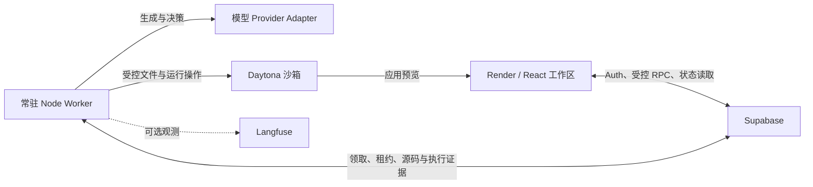

# Forge — 从需求到可交互网页

Forge 是一个面向 React 网页与小游戏的 idea-to-app 原型。用户描述需求、审阅初始计划后，Agent 在 Daytona 沙箱中编写和运行应用；之后可以继续提需求、编辑代码、查看版本，或恢复历史版本的源码。

**体验入口：[Forge Demo](https://idea-to-app-forge.onrender.com/)**。测试账号通过交付渠道单独提供，不放在公开仓库中。当前交付方式是 **Render 静态前端 + 本地 WSL Worker + Supabase + Daytona**。Worker 并未部署为全天在线的云服务：本地电脑或 Worker 离线时，新任务和预览恢复会等待处理。

本文按当前源码整理，更新于 **2026-10-21**。项目仍是 Demo：模型生成可能失败，服务检查也不等于功能正确，不能保证任意需求一次成功。

## 如何体验

1. 注册或登录，新建项目并描述需求。没有稳定版本时默认先生成 Initial Plan，审阅后批准开发。
2. 在 Chat 中查看关键进度，在右侧查看 Plan、Preview、代码和 App Versions。
3. 已有应用后，普通后续需求默认走轻量 action，再修改当前工作区；仍可显式选择正式 Plan。
4. 在代码编辑器修改已有文本文件，点击 Apply Changes。提交后由 Worker 确认源码、构建并检查，完成后才产生新版本；这条路径不调用 LLM。
5. 点击历史版本可查看只读源码；恢复到当前工作区是独立操作，需要重新确认源码和运行证据，不是瞬时切换一个静态网页。

版本代表代码与检查证据，**不代表业务数据的历史快照**。恢复旧代码不默认清空用户数据。检查有 warning / inconclusive 时，版本会保留标记；blocker / tool_error 不发布可用 checkpoint。

## 架构



| 目录 | 用途 |
| --- | --- |
| `app/frontend` | React / Vite 工作区、登录、Chat、代码编辑器、版本与预览 |
| `app/worker` | 模型调用、任务执行、工作区协议、构建、检查和恢复 |
| `app/shared` | 环境隔离、预览启动与业务数据桥接等共享代码 |
| `app/backend/migrations` | 按顺序执行的 Supabase SQL migrations |
| `app/backend/tests` | 本地 PGlite 权限、状态与并发语义回归 |

Supabase 保存认证、项目、计划、任务、源码、ChangeSet 和 checkpoint；它不会替代 Worker。生成应用运行于 Daytona，也不会自动获得自己的云端业务数据库。

所有受管源码改动复用 `workspace_revision`、canonical manifest、`ita_changesets` 和 writer fencing。构建和检查证据绑定源码与稳定 basis；结果不明时先 reconcile，不能只清空状态或重新写一遍。

## 本地运行

需要 Node.js **20+**、pnpm、一个独立 Supabase 项目、Daytona 凭据，以及所选模型可用的接口凭据。前端使用 `pnpm-lock.yaml`，Worker 与数据库测试使用各自的 `package-lock.json`。以下命令适用于 Linux / WSL，从仓库根目录开始。

### 1. 数据库

**新建空库**需要在自己的 Supabase 项目中，按文件编号执行 [migrations](app/backend/migrations)：

| 顺序 | 文件 | 主要能力 |
| --- | --- | --- |
| 0001–0005 | `0001_init.sql` → `0005_preview_recovery.sql` | 基础表、计划批准、删除、暂停与预览恢复 |
| 0006 | `0006_workspace_contract.sql` | 受管源码、ChangeSet、revision、fencing 与 checkpoint |
| 0007 | `0007_app_versions.sql` | 编号版本与 parent |
| 0008 | `0008_user_apply.sql` | 零 LLM 的手动 Apply 请求 |
| 0009 | `0009_preview_basis.sql` | 预览运行依据 |
| 0010–0011 | `0010_product_editor.sql` → `0011_editor_intent.sql` | 编辑器提交及说明 |
| 0012–0013 | `0012_restore_app_version.sql` → `0013_active_app_version.sql` | 恢复历史源码与用户可见版本身份 |

不要重跑已执行的迁移。升级已有数据库前应停止旧 Worker、确认远程副作用收尾、备份并核对兼容性；特别是 0006 会收紧旧的直接源码写入权限，不能与旧 Worker 混跑。[旧库 0006 切换说明](docs/workspace-cutover.md)仅适用于该次协议升级，不是 Demo 的日常启动步骤。

在 Supabase Auth 中配置 Email 登录、注册策略及允许的跳转地址。本地示例 origin 为 `http://localhost:5173`；公网需使用实际前端 origin。开启邮箱确认后，用户需完成邮件确认才能登录。

### 2. 显式环境身份

当前环境 guard 支持 `atoms-demo` 和指定 Main 的 `production-main`。独立试运行使用 **自己的 Supabase 项目 + atoms-demo**；`atoms-demo` 会拒绝仓库中已知的 Main / restore-test。`production-main` 是既有环境的显式边界，不是新用户的通用部署配置，也不表示 Main 已完成生产切换。

前端和 Worker 必须配置同一个真实 project ref。Demo 配置必须完整、显式，不能缺值后从其他 `.env` 补入。Daytona sandbox 同时校验 environment、Supabase ref、project 和 user；未标记或其他项目的沙箱不能自动接管。labels 是应用隔离措施，不是凭据安全边界，独立凭据仍更合适。

### 3. 前端

```bash
cd app/frontend
pnpm install --frozen-lockfile
test -f .env.atoms-demo || cp .env.example .env.atoms-demo
```

填写该文件，所有占位值必须替换：

```dotenv
VITE_FORGE_ENVIRONMENT_ID=atoms-demo
VITE_EXPECTED_SUPABASE_PROJECT_REF=YOUR_PROJECT_REF
VITE_SUPABASE_URL=https://YOUR_PROJECT_REF.supabase.co
VITE_SUPABASE_ANON_KEY=YOUR_PUBLIC_KEY
```

```bash
pnpm run dev --mode atoms-demo --port 5173 --strictPort
```

所有 `VITE_*` 都会进入浏览器构建，只能放公开配置；修改后需要重启开发服务或重新构建。Supabase service-role、模型和 Daytona 密钥不能放到前端。

### 4. Worker

在另一个终端，从仓库根目录执行：

```bash
cd app/worker
npm ci
test -f .env.demo || cp .env.example .env.demo
```

至少配置以下字段；模型和接口地址应以自己账号实际可用的配置为准：

```dotenv
FORGE_ENVIRONMENT_ID=atoms-demo
EXPECTED_SUPABASE_PROJECT_REF=YOUR_PROJECT_REF
SUPABASE_URL=https://YOUR_PROJECT_REF.supabase.co
SUPABASE_SERVICE_ROLE_KEY=YOUR_SERVER_KEY
LLM_PROVIDER=aliyun
LLM_BASE_URL=https://YOUR_ALIYUN_ENDPOINT/compatible-mode/v1
LLM_MODEL=YOUR_AVAILABLE_MODEL_ID
ALIYUN_API_KEY=YOUR_MODEL_KEY
DAYTONA_API_KEY=YOUR_DAYTONA_KEY
DAYTONA_API_URL=https://app.daytona.io/api
DAYTONA_AUTO_STOP_MINUTES=120
FORGE_PUBLIC_ORIGIN=http://localhost:5173
```

`FORGE_PUBLIC_ORIGIN` 必须是承载 Forge 预览的可信前端 origin，不能直接照抄公网默认值用于本地前端。完整配置见 [Worker .env.example](app/worker/.env.example)，模型差异见 [Provider 配置](docs/provider-capabilities.md)和[阿里云配置](docs/aliyun-provider.md)。其他入口包括 DeepSeek、智谱、OpenRouter、Gemini、Ollama 和 LM Studio；支持 adapter 不等于所有模型均经过真实验收。Ollama / LM Studio 可以不填 API Key。

在 Worker 目录显式选择同一份文件：

```bash
FORGE_ENV_FILE="$PWD/.env.demo" npm run doctor:llm
FORGE_ENV_FILE="$PWD/.env.demo" npm start
```

`doctor:llm` 做配置与可用时的 GET `/models` 检查，不发送生成请求。Worker 自身也会校验环境与 schema 后才领取任务。`doctor`、`smoke:llm` 可能发送真实模型请求；启用强制费用保护时，没有任务级预算上下文的诊断生成会被拒绝。`smoke:daytona` 会创建测试沙箱，不能当作只读自检。

启动成功会记录 `worker.started`，空闲时记录 `worker.polling`。目前按单 Worker 运行，不要同时手动启动第二个实例。`task.fail_write_rejected` 表示状态写回未确认：先检查原任务、租约及 workspace，不能只看旧页面或无限重启进程。

### 5. 预算和检查模式

- `MAX_TOOL_STEPS=40`、`MAX_FIX_ROUNDS=1`：默认工具步数与构建修复额度；不等于模型调用次数。
- `LLM_TIMEOUT_MS=120000`、`TASK_TIMEOUT_MS=900000`：默认模型请求与整轮执行时限；超时不代表余额不足。
- `LLM_MAX_OUTPUT_TOKENS_*`、`LLM_REQUIRE_COST_BUDGET`：可信输出和累计理论费用保护，详见[预算配置](docs/llm-budget.md)。不是模型余额查询，也不是整个项目的总价封顶。
- `BROWSER_VERIFICATION_ENABLED=true`：默认运行浏览器检查。当前交付 Demo 显式设为 false，只做构建、HTTP/入口检查及应用显式启用的纯逻辑测试；浏览器渲染和功能交互仍是 **inconclusive**。

Agent 的明确 blocker 可以触发一次受限快速修复：最多 4 次模型调用、共享 90 秒决策/派发预算，仍受原费用与验收次数限制。已经发出的操作必须安全收尾，所以这不是整个恢复过程的硬墙钟上限。User Apply / Restore 不进入模型修复。[验收和修复边界](docs/verification-repair.md)说明哪些失败会停止。

## 预览、版本和业务数据

- 健康的预览在工作区刷新和重进时复用。只有明确故障才走已有恢复队列；停止的 sandbox 需要冷启动，Worker 离线时无法恢复。已删除或缺失的 sandbox 尚不自动重建。
- 初次加载异常可以在没有用户操作、待保存数据且状态允许时，同一 URL 安全重载一次；不会无限刷新。错误宿主、数据损坏或未确认写入保留诊断并停止。
- App Versions 保存不可变源码与证据。恢复旧版本会走正常 workspace mutation 和检查，再把用户可见 Current 指回所选 App；后续实际编辑产生下一个编号。尚无并行运行的历史 Preview 或 branch / merge。
- 业务状态由可信 Forge 父页面的浏览器存储按 environment、Supabase、账号和项目隔离；预览桥接 localStorage，避免仅因 Daytona 代理域名改变就换一个数据空间。刷新、同浏览器退出再登录、兼容代码修改沿用该数据空间。
- **任意未保存的内存状态无法自动恢复。** 应用仍需将要保留的数据写入 localStorage / 提供的 helper；游戏应保存可恢复局面。sessionStorage、IndexedDB、跨浏览器同步和清除浏览器数据后的恢复不在当前能力内。
- “重置业务数据”是显式操作，和代码恢复分开。坏 JSON、未知 schema 或迁移失败不能静默覆盖原数据为空。

详细契约见[版本与数据状态](docs/app-version-and-platform-state.md)。项目源码从平台持久化文件导出 ZIP；运行方式以导出项目的 `package.json` 为准。任意 shell 改写、二进制资源、install hooks 和完整全栈部署不属于当前通用支持范围。

## 本地验证

```bash
# Worker：本地单元/集成测试；不启动真实 Worker
cd app/worker
FORGE_ENV_FILE=/absolute/path/to/offline.env \
FORGE_NO_MAIN=1 LANGFUSE_ENABLED=false \
NODE_OPTIONS="--import=$PWD/tests/fixtures/offline-network.mjs" npm test
npm run check
```

`offline.env` 应是独立假配置，不是 Main / restore-test 或真实 Demo 的配置；显式填写 atoms-demo 身份、一个测试 ref 和相同 ref 的 Supabase URL，Key 可使用测试占位值。网络阻断 fixture 随仓库提供，测试自己的 mock 仍可工作，不启动真实 Worker，也不访问真实模型或沙箱。

```bash
# 前端：不发布、不运行真实生成任务
cd app/frontend
pnpm run lint
pnpm exec tsc --noEmit
pnpm run build --mode atoms-demo
```

`pnpm run test:ui` / `pnpm run test:product` 是本地 UI fixture 测试，需要兼容的 Playwright Chromium；它们不等于公网真实模型生成验收。

数据库回归位于 `app/backend/tests`，例如 `node rls.test.mjs`、`node plan.test.mjs`、`node deletion.test.mjs`、`node pause.test.mjs`、`node preview-recovery.test.mjs` 和 `npm run test:privileges`。这里的总 `npm test` 仍是占位脚本；不要把它当作所有数据库回归入口。

截至本次整理，Worker **413/413** 离线测试以及前端 lint、TypeScript、构建通过。数据库真实权限/双连接并发、Daytona fixture 和公网生成曾分阶段验证，属于各自版本与条件下的证据；本轮文档整理未重跑这些远程操作，也不代表任意生成应用已通过功能验收。

## 部署与已知限制

Render 前端使用 `app/frontend`，构建 `pnpm install --frozen-lockfile && pnpm run build --mode atoms-demo`，发布 `dist`，并配置 SPA Rewrite `/*` → `/index.html`。构建环境要提供完整的四项 `VITE_*` 身份配置。源码推送是否触发部署取决于 Render 的分支和自动部署设置。

Worker 需要独立常驻进程及同版本 schema。目前交付使用本地 WSL 手动启动，未配置开机自动运行，也不是由 Render 前端唤醒。关闭浏览器不会停止后台任务，电脑休眠或 Worker 退出则无法继续处理。当前没有生产 HA 或全天在线保证。

| 现象 | 检查方向 |
| --- | --- |
| `LLM_COST_BUDGET_EXCEEDED` | Forge 的执行级理论费用保护，不是余额不足；看[预算说明](docs/llm-budget.md) |
| `LLM_TIMEOUT` / `LLM_NETWORK` | 查看请求阶段、响应头及网络证据；不要据此推断充值即可解决 |
| `LLM_OUTPUT_TRUNCATED` / `LLM_FORMAT_STALLED` | 检查输出截断、协议或模型兼容性，不执行半份文件 |
| 页面空白 / `SANDBOX_NOT_RUNNING` | 从 Forge 工作区进入，检查 Worker、sandbox 生命周期、HTTP 与预览诊断 |
| `APP_STORAGE_HOST_MISMATCH` | 核对可信前端 origin 和父窗口握手，不清空业务数据来绕过 |
| `WORKSPACE_UNCERTAIN` / `PARTIAL` / `CONFLICT` | 保留原源码和沙箱，按 reconcile 核对副作用；不要手改 revision / writer 解锁 |
| 服务检查完成但功能不对 | HTTP 成功不是功能成功；查看实际交互、逻辑测试或修订验收依据 |

仍未提供：任意后端/数据库自动生成部署、跨设备业务数据同步、复杂自动 merge、数据库历史回滚、多 Worker 生产扩容，以及有统计依据的成功率、延迟和费用保证。生成模型自己的测试也不是独立正确性证明。

可选 Langfuse 默认不开启内容采集；配置 `LANGFUSE_ENABLED`、区域地址及公私钥后用于调用/用量观测。上传模型内容可能包含源码或用户需求，应显式选择。数据库级 RLS、受控 RPC、执行许可和 sandbox ownership fence 不能替代完整生产安全审计。

## 文档入口

[文档导航](docs/README.md)按运行配置和关键实现机制组织。旧 Main cutover、review 阶段和环境恢复记录列入[历史资料](docs/history.md)，不作为当前 Demo 启动或操作指令。个人笔试说明不随仓库发布。
